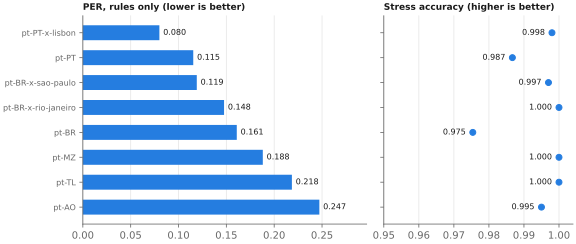

# tugaphone documentation
<!-- agent-hint
covers: the reading order of every documentation page
source: docs/
generated: no
verify: diff <(ls docs/*.md | xargs -n1 basename | grep -v '^index.md$' | sort) <(grep -o '^| \[[^]]*\]([a-z_]*\.md)' docs/index.md | sed 's/.*(\(.*\))/\1/' | sort)
see: README.md, AGENTS.md
-->

`tugaphone` turns Portuguese text into IPA for each Lusophone dialect.

<picture>
  <source media="(prefers-color-scheme: dark)" srcset="img/scoreboard-dark.svg">
  
</picture>

The [Scoreboard](scoreboard.md) gives every value of this figure.

## Quickstart

```bash
uv pip install --prerelease=allow tugaphone
```

```python
from tugaphone import TugaPhonemizer

ph = TugaPhonemizer()
for code in ["pt-PT", "pt-BR", "pt-AO"]:
    print(code, "→", ph.phonemize_sentence("O gato dorme.", code))
# pt-PT → u ˈɡatu ˈdɔɾmɨ
# pt-BR → u ˈɡatu ˈdoɾmi
# pt-AO → ʊ ˈɡatʊ ˈdɔʁmɨ
```

## Pages

The pages follow the reading order, from the first call to the internals and the benchmarks.

| Page | What you get from it |
|---|---|
| [Quickstart](quickstart.md) | Install the package and phonemize a first sentence in each dialect |
| [Comparison](comparison.md) | How tugaphone compares with espeak-ng and other Portuguese G2P tools |
| [Architecture](architecture.md) | The stages that tugaphone and orthography2ipa each own |
| [Dialects](dialects.md) | The lect codes, the legacy aliases and the lects that take a lexicon |
| [Accent forcing](accent_forcing.md) | Force an accent into a TTS voice as IPA, respelled text or an overlay |
| [Homographs](homographs.md) | How bifonia picks the vowel quality of a heterophonic homograph |
| [Code-switch](codeswitch.md) | Detect and nativize English, Spanish and French words inside Portuguese text |
| [Numbers](numbers.md) | Read numbers, dates, times and money as words for each lect |
| [Text normalization](text_normalization.md) | The old spellings, abbreviations, Roman numerals, acronyms and codes that tugaphone rewrites |
| [API](api.md) | Every public class and function with its signature and default |
| [Advanced](advanced.md) | The lexicon boundary, number scales and the sibling libraries |
| [Development](development.md) | Set up a checkout, run the tests and find the file that owns each stage |
| [Benchmarking](benchmarking.md) | The scripts that measure accuracy and the regression gate |
| [Scoreboard](scoreboard.md) | The rules-only PER and stress accuracy of each dialect, generated by `scripts/benchmark.py` |
