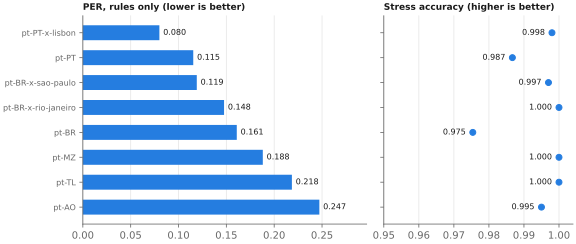

# Scoreboard: rules-only PER and stress accuracy per dialect
<!-- agent-hint
covers: the rules-only PER and stress accuracy of each dialect
source: benchmarks/results.json, tests/data/gold/
generated: yes, by scripts/benchmark.py. Edit the generator, not the page
verify: .venv/bin/python -c "import json,re;r={x['dialect']:x for x in json.load(open('benchmarks/results.json'))};t=re.findall(r'^\\| (\\S+) \\| \\S+ \\| (\\d+) \\| ([\\d.]+) \\|',open('docs/scoreboard.md').read(),re.M);assert len(t)==len(r) and all(float(p)==r[d]['per'] and int(n)==r[d]['n'] for d,n,p in t)"
see: benchmarking.md
-->

Generated by `python scripts/benchmark.py` from the committed reference
fixtures (`tests/data/gold/`), which are fixed-seed samples of
[TigreGotico/portuguese-unified-pronunciation-lexicon](https://huggingface.co/datasets/TigreGotico/portuguese-unified-pronunciation-lexicon).

Rules-only: the packaged lexicon is emptied, so the number measures
the rules, not the lexicon. See [benchmarking.md](benchmarking.md).

Stress accuracy is the share of the stress-eligible reference words
(one word, one primary mark, two syllables or more) whose primary
stress lands on the reference syllable. PER cannot see that choice.

<picture>
  <source media="(prefers-color-scheme: dark)" srcset="img/scoreboard-dark.svg">
  
</picture>

`img/plot_scoreboard.py` makes this figure from
`benchmarks/results.json`. It shows only the dialects with human gold.

PER, variants accepted counts each reading of a cited optional process as
one: for European Portuguese a word-initial ⟨es⟩ vowel (Vázquez Diéguez
2015: 250, 265), a glide before a vowel (Mateus & Andrade 1998;
Cruz-Ferreira 1999: 128) and the phones of the strong R (Pereira 2020: iii);
for Brazilian Portuguese the strong R, an unstressed ⟨a⟩, a nasal vowel before a nasal onset, the coda /R/ and /S/, the word-final /R/ and the glide before a
vowel (Barbosa & Albano 2004: 228, 230), epenthesis in a written obstruent cluster
(Collischonn 2004: 64, 67) and the glide of a final stressed vowel before
/S/ (Leiria, Organon 28: 133). See docs/benchmarking.md.

## PER against human gold

| Dialect | Gold region | Words | PER | PER, variants accepted | Word accuracy | Stress words | Stress accuracy |
|---|---|---|---|---|---|---|---|
| pt-BR | pt-BR | 993 | 0.0973 | 0.0526 | 0.4804 | 895 | 0.9765 |
| pt-PT | pt-PT | 1000 | 0.0768 | 0.0478 | 0.5130 | 995 | 0.9879 |

## Edits that each accepted process absorbs

Each cell is the number of edits that come back when the process is the
one process that does not run. Two processes can absorb the same edit,
so a column does not add up to the gap between strict and accepted PER.

| Process | Lects | Source | pt-BR | pt-PT |
|---|---|---|---:|---:|
| glide | pt-PT pt-BR | Mateus & Andrade 1998; Cruz-Ferreira 1999: 128; Barbosa & Albano 2004: 230 | 36 | 173 |
| strong_r | pt-PT pt-BR | Pereira 2020: iii; Barbosa & Albano 2004: 228 | 19 | 89 |
| initial_es | pt-PT | Vázquez Diéguez 2015: 250, 265 |  | 0 |
| pretonic_a | pt-BR | Barbosa & Albano 2004: 229-230 | 48 |  |
| final_a | pt-BR | Barbosa & Albano 2004: 229-230 | 26 |  |
| nasal_onset | pt-BR | Barbosa & Albano 2004: 230 | 48 |  |
| coda_r | pt-BR | Barbosa & Albano 2004: 228; Cristófaro Silva 2025: 246; Gregio 2012: 81 | 124 |  |
| final_r | pt-BR | Barbosa & Albano 2004: 228; Callou, Moraes & Leite 1998: 67 | 38 |  |
| coda_s | pt-BR | Barbosa & Albano 2004: 229; Brito 2016: 141 | 22 |  |
| epenthesis | pt-BR | Collischonn 2004: 64, 67 | 29 |  |
| final_glide_s | pt-BR | Leiria, Organon 28: 133 | 8 |  |

## Agreement with a machine reference (Portal LUPo)

The reference rows of these dialects come from the Portal da Língua
Portuguesa. The Portal makes them with its rule-based LUPo generator,
so they are machine output, not human gold. The rate is the share of
segments where tugaphone and LUPo disagree. A disagreement is not
always a tugaphone error.

| Dialect | Reference region | Words | Disagreement | Disagreement, variants accepted | Word agreement | Stress words | Stress agreement |
|---|---|---|---|---|---|---|---|
| pt-AO | pt-AO | 1000 | 0.2395 | n/a | 0.1010 | 993 | 0.9970 |
| pt-BR-x-rio-janeiro | pt-BR-x-riodejaneiro | 1000 | 0.1721 | 0.1318 | 0.1380 | 992 | 1.0000 |
| pt-BR-x-sao-paulo | pt-BR-x-saopaulo | 1000 | 0.1535 | 0.1086 | 0.1930 | 992 | 0.9980 |
| pt-MZ | pt-MZ-x-maputo | 1000 | 0.1377 | n/a | 0.2940 | 992 | 1.0000 |
| pt-PT-x-lisbon | pt-PT-x-lisboa | 1000 | 0.0683 | 0.0388 | 0.5750 | 994 | 0.9980 |
| pt-TL | pt-TL-x-dili | 1000 | 0.3644 | n/a | 0.0140 | 985 | 0.9970 |

---
[← Benchmarking](benchmarking.md) · [Home](index.md)
